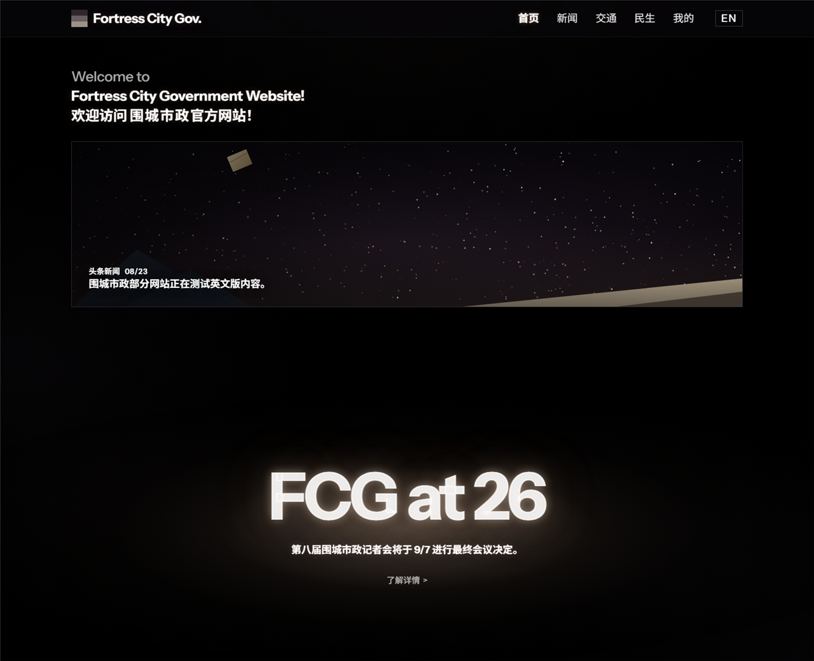
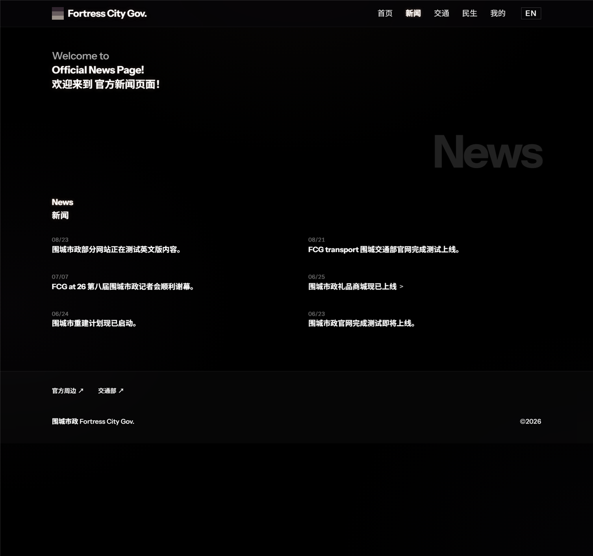
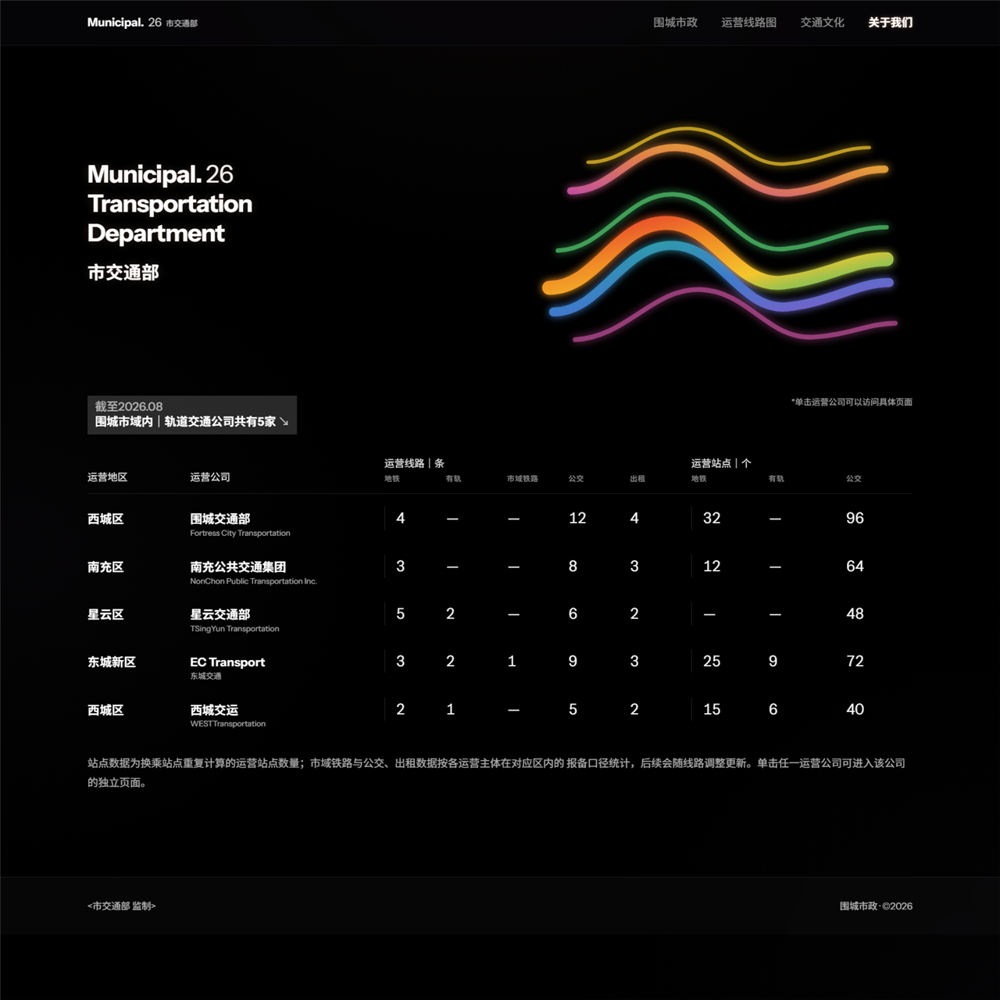
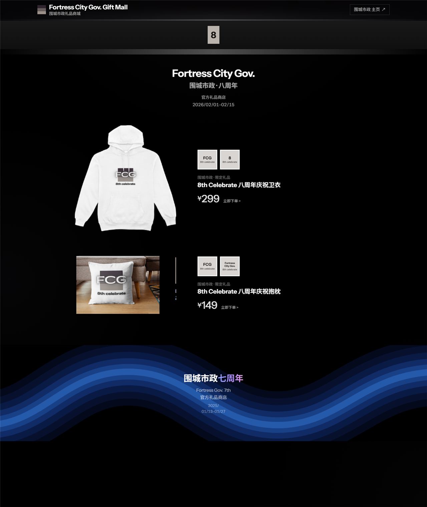

# 围城市政 Fortress City Gov.

一个 **虚构城市政府** 的网站群，排版来自 <https://toki.my.canvasite.cn/fc-gov>：
纯黑舞台、白色字、暖琥珀文字光晕、超大的幽灵水印字。

纯静态 HTML / CSS / JS，零构建、零依赖。

**线上：** <https://ichiyotsu.github.io/FortressCity/>
**仓库：** <https://github.com/ichiyotsu/FortressCity>

| 首页 | 新闻 |
| --- | --- |
|  |  |

| 交通部 | 礼品商城 |
| --- | --- |
|  |  |

---

## 三个独立站点

围城市政、市交通部、礼品商城是 **三个互相独立** 的二级网站，只在导航处互相跳转，不共用页头页脚：

| 站点 | 入口 | 独立特征 |
| --- | --- | --- |
| **围城市政** | `/` | 顶部磨砂常驻栏 + 主导航 + 语言切换 |
| **市交通部** | `/transport/` | 自己的 `Municipal. 26` 顶栏、彩色色带、运营数据表 |
| **礼品商城** | `/shop/` | 自己的商城顶栏，只有 logo 和返回主页的入口 |

## 页面

| 路径 | 内容 |
| --- | --- |
| `/` | 欢迎语 + 头条新闻卡（满宽）+ 巨型 `FCG at 26` |
| `/news/` | 新闻列表，桌面端 **两列**，按日期倒序 |
| `/news/<日期>/` | 6 篇新闻详情 |
| `/transport/` | 市交通部：5 家运营主体的线路 / 站点数据表 |
| `/transport/<公司>/` | 5 家公司页：围城交通部、南充公共交通集团、星云交通部、EC Transport、西城交运 |
| `/transport/lines/`、`/culture/` | 运营线路图、交通文化 |
| `/livelihood/` | 民生，桌面端两列 |
| `/me/` | 市民个人页面（`您还不是围城市的市民`） |
| `/shop/` | 礼品商城：八 / 七 / 六 / 五周年 |
| `/en/…` | 英文版：首页、新闻（列表 + 6 篇）、民生、我的、404 |

## 设计要点

| 元素 | 做法 |
| --- | --- |
| 顶栏 | `position: sticky` + `backdrop-filter: blur(22px) saturate(150%)`，滚动后加深；手机端塌成「菜单」下拉面板 |
| 页脚 | 半透明 + 磨砂，但 **不常驻** |
| 光晕 | 取自原站的暖琥珀 `text-shadow`：`rgba(165,108,68)` + `rgba(165,137,118)` 三层 |
| 幽灵字 | `News` / `Livelihood` / `404`，统一字号、统一亮度，右对齐到内容边缘 |
| 巨幅标题 | `FCG at 26` 用 700 字重 + `text-stroke` 加厚 |
| 语言切换 | 顶栏最右 `EN` / `中文`，逐页对应真实英文页面 |
| 交通顶栏 | 桌面端滚过按钮行即吸顶；手机端是「菜单」按钮 |
| 数据表 | 桌面 10 列完整展示；手机端可左右滑动，并提示「左右滑动查看完整表格」 |
| 商城周年 | 六 / 五周年标记用涂鸦字体 [Sedgwick Ave Display](https://fonts.google.com/specimen/Sedgwick+Ave+Display)（OFL） |

## 与初版的差别

- 去掉了全部页面的「观影须知」公告条。
- 去掉了页脚最下面的「虚构城市政府网站 · Test Version」。
- 去掉了顶栏字标旁的 `2026 / Test Version`，字标与 logo 垂直居中。
- 交通部标题由 `Fortress City Gov. 26 / … Website` 改为 `Municipal. 26 / Transportation Department`，中文改为「市交通部」；去掉了 `Test Version` 角标和背景灰 `FCG` / `26`，右侧换成彩色色带。
- 交通部表格改名为：围城交通部 / 南充公共交通集团 / 星云交通部 / EC Transport（东城交通）/ 西城交运；线路列改为 地铁 / 有轨 / 市域铁路 / 公交 / 出租，站点列改为 地铁 / 有轨 / 公交。
- 删掉了「公共交通公司共有 3 家」整块、以及旧的 `围城轨道交通` 单页（拆成 5 家公司页）。
- 礼品商城改为独立站，商品图直接取自原站截图，补上了五周年。

## 目录

```text
.
├─ index.html                 # 围城市政 首页
├─ news/                      # 列表 + 6 篇详情
├─ livelihood/  me/  404.html
├─ en/                        # 英文版镜像
├─ transport/                 # 市交通部（index + 5 家公司 + lines + culture）
├─ shop/                      # 礼品商城（独立站）
├─ assets/
│  ├─ css/  tokens · base · site · transport · shop
│  ├─ js/   site.js           # 吸顶状态 / 手机菜单 / 淡入
│  ├─ img/  products/ 商品图（取自原站）
│  ├─ fonts/ Instrument Sans · Sedgwick Ave Display · OFL
│  └─ img/  logo、starfield、ribbon、shop-waves、og
├─ robots.txt · sitemap.xml · site.webmanifest · .nojekyll
└─ README.md
```

## 改内容

页面由 `_build/` 里的两个脚本生成（不发布），**改文案请改脚本或直接改 HTML**：

```powershell
# 围城市政 + 英文版（22 页）
Set-ExecutionPolicy -Scope Process Bypass -Force
D:\DSH\FortressGov\_build\gen.ps1

# 市交通部（8 页）
D:\DSH\FortressGov\_build\gen-transport.ps1
```

| 想改什么 | 去哪里 |
| --- | --- |
| 首页 / 新闻 / 民生 / 我的 / 英文版文案 | `_build/gen.ps1`（`$frag` 与 `$newsZh` / `$newsEn`） |
| 交通部文案与表格数据 | `_build/gen-transport.ps1`（`$orgs`） |
| 商城商品与周年 | `shop/index.html`、`assets/css/shop.css` |
| 颜色 / 光晕 / 字号 | `assets/css/tokens.css` |
| 页头页脚 / 列表 / 详情 | `assets/css/site.css` |

## 本地预览

```powershell
python -m http.server 4173
# http://127.0.0.1:4173/
```

## 发布

```powershell
# 本机没有 git，用增量发布脚本（按 SHA256 只传改过的文件）
Set-ExecutionPolicy -Scope Process Bypass -Force
D:\DSH\FortressGov\_build\publish.ps1
```

脚本走 GitHub API：创建 blob → tree → 单个 commit → 推送 `main`，Pages 自动重建。

## 多仓库多站点

| 仓库名 | 站点地址 |
| --- | --- |
| `ichiyotsu.github.io` | `https://ichiyotsu.github.io/`（根站点，另一个仓库） |
| `FortressCity` | `https://ichiyotsu.github.io/FortressCity/`（本站） |

仓库名不是 `<用户名>.github.io` 时，站点挂在子路径下——所以本站所有链接都是相对路径；
`canonical` / `sitemap` / `og:url` 是绝对地址，换域名要一起改。

## 说明

- 内容属于**虚构城市设定**，与任何真实政府机构无关。
- 商品图截取自原站页面；新闻详情正文是把标题改写成短段落，没有新增虚构事实。
- 交通部表格里的「公交 / 出租」数字是按合理值填的示意数据，可随时改。

## Credits

- 字体：[Instrument Sans](https://github.com/Instrument/instrument-sans)（OFL）、
  [Sedgwick Ave Display](https://fonts.google.com/specimen/Sedgwick+Ave+Display)（OFL）
- 视觉参考与文案：[toki.my.canvasite.cn/fc-gov](https://toki.my.canvasite.cn/fc-gov)

## License

页面代码可自由参考和修改。城市设定与文案归原作者所有。
